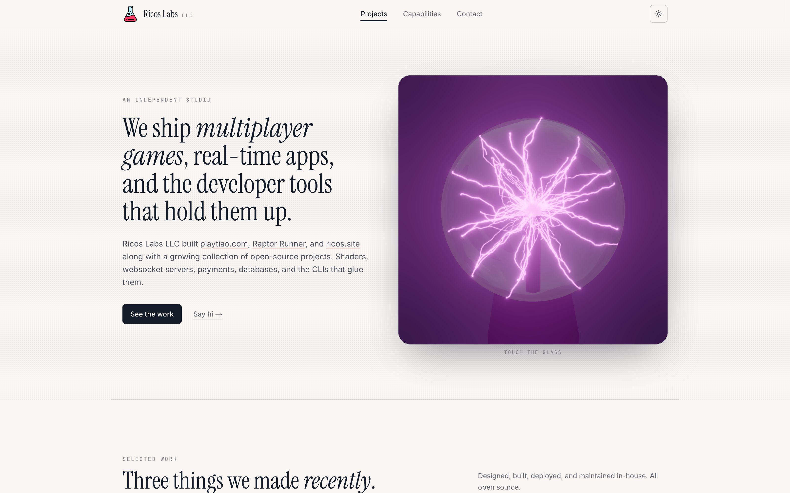
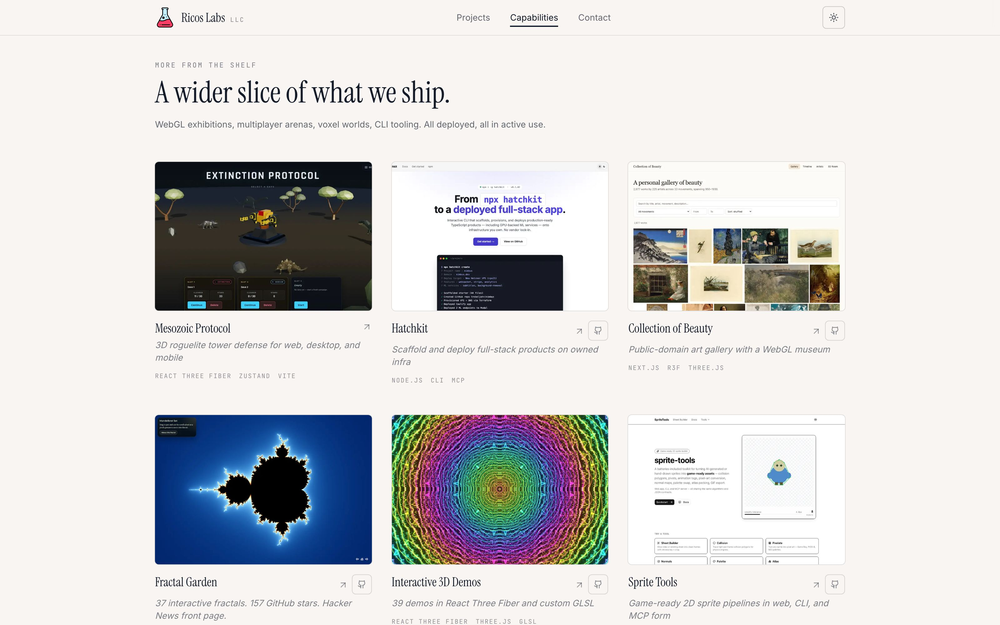

# ricoslabs.com

[](LICENSE)
[](https://github.com/trebeljahr/ricos-labs/actions/workflows/deploy.yml)



The website of Ricos Labs LLC, the studio through which Rico Trebeljahr ships games, real-time apps and developer tools. It answers the questions a possible client asks first: what has the studio shipped, what can it build, and how do I reach it.

The page shows 15 projects. Each card links to the live product, and 14 of them also link to their source code. Below the projects are the studio's capabilities, its past clients and a contact address.

Visit **[ricoslabs.com](https://ricoslabs.com)**. For everything Rico makes, including his writing and explorables, the hub is [ricos.site/projects](https://ricos.site/projects).

## What's on the page



- A hero with a WebGL plasma ball whose filaments follow the pointer. It renders only when the visitor allows motion.
- Three featured projects (Tiao, Raptor Runner, ricos.site) and a grid of 12 more.
- Six capability areas, from real-time multiplayer to tooling.
- Past clients as plain text, with what was built for each.
- A light and a dark theme, plus `/imprint` and `/privacy`.

## Run it locally

You need Node.js 22 or newer and pnpm 11.

```bash
pnpm install
pnpm dev        # Next.js dev server on port 3947
```

On a machine with hatchkit's local-dev setup, `pnpm dev` also points the project's dev URL at this server ([docs/dev-setup.md](docs/dev-setup.md)). Run with `HATCHKIT_LOCAL_DEV=0` to turn that off.

| Command | What it does |
| --- | --- |
| `pnpm build` | Static export to `packages/client/out`, then WebP sizes of the screenshots |
| `pnpm preview` | Serves the last build with `wrangler dev`, with the production asset rules |
| `pnpm typecheck` | `tsc --noEmit` in the client |
| `pnpm test` | Tests for the release scripts |
| `pnpm screenshots` | Recaptures the project screenshots in `packages/client/public/images` from the live sites |

## Releases

Every push to `main` builds the export and releases it to ricoslabs.com as a new version of the Cloudflare Worker `ricos-labs-client`. The workflow then checks that the public site serves the pushed commit. Routes, the rollout switch, secrets and rollback are in [docs/RELEASE.md](docs/RELEASE.md).

## Project structure

```
packages/client/       the site (one pnpm workspace package, @starter/client)
  src/app/             App Router: landing page, imprint, privacy, metadata routes
  src/components/      landing sections, react-three-fiber scenes, brand mark
  src/lib/             site-config.ts (names, contact, SEO), projects-data.ts
  public/              brand files, project screenshots, the hero's HDRI
  wrangler.jsonc       the assets-only Worker
scripts/               release helpers and the screenshot capture
docs/                  release contract, dev setup, marketing images
BRAND.md               palette, type, assets and voice
```

## Tech stack

- Next.js 15 (App Router) with `output: "export"`, React 19, TypeScript
- Tailwind CSS 3 and `next-themes`
- three, React Three Fiber, drei and postprocessing for the hero scene
- Cloudflare Workers static assets for hosting
- Plausible for aggregate visit counts, loaded only in production

## License

The code is licensed under the [GNU AGPL-3.0-or-later](LICENSE).

The licence covers code only. Rico's writing, photos and images are © Rico Trebeljahr, all rights reserved. Third-party assets keep their own licences, for example the hero's HDRI from Poly Haven (CC0, see `packages/client/src/components/three/hero-scene.tsx`).

## Support

You can support Rico's open work at [ricos.site/donate](https://ricos.site/donate).
